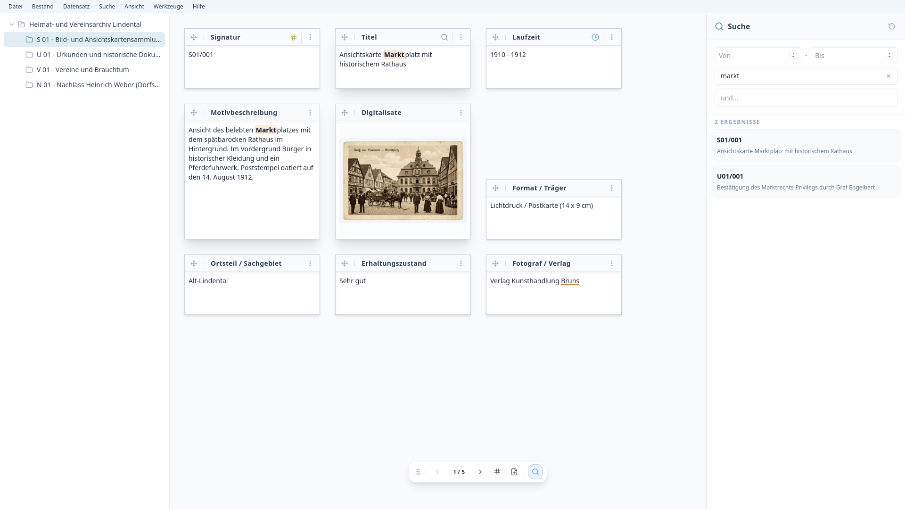
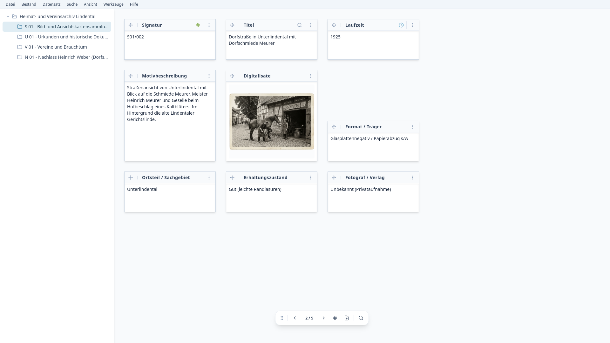
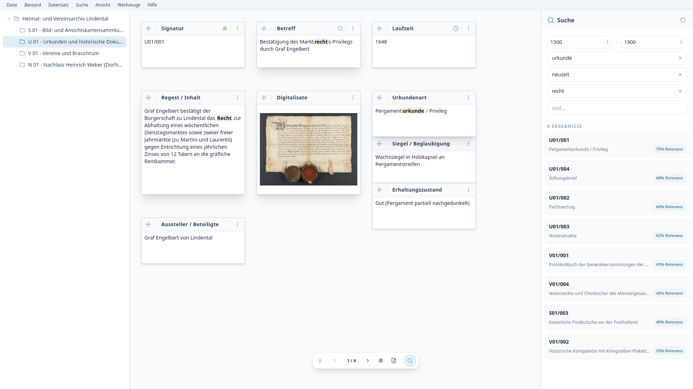

# Fontis – Freies Archivinformationssystem

[](LICENSE)

**Fontis** ist ein freies, lokales Archivfachinformationssystem (AFIS) für kleine und mittlere Archive, Vereine, Heimatforscher, Museen und private Sammlungen.

Alle Daten bleiben vollständig auf dem eigenen Rechner – als einzelne, portable SQLite-Datenbank ohne Cloud, ohne Abos und ohne externe Server.

> **English Summary:**
> **Fontis** is a free, open-source, local-first archival information system (AFIS) designed for small archives, local history societies, clubs, and private collections. Built with **React + Vite + Tailwind CSS** on the frontend and **FastAPI + SQLite (FTS5)** on the backend, wrapped in a native desktop window via **pywebview**. It supports hierarchical archival tectonics, freely customizable form layouts, local digital asset attachments (images, PDFs, audio, video), offline spell-checking, full-text & optional local semantic search, PDF finding-aid (*Findbuch*) generation, JSON/CSV/EAD-XML import & export, and automatic local backups. Licensed under the [MIT License](LICENSE).

---

## Einblicke in die Oberfläche


*Archivtektonik, frei gestaltbare Erfassungsmaske mit eingebundenem Digitalisat, Rechtschreibprüfung und Live-Suche.*


*Fokussierte Erfassungsansicht mit verschiebbarer Schnellzugriffsleiste.*


*Zeitraum- und semantische Suche (mit Relevanzbewertung) sowie direkte Vorschau historischer Urkunden.*

## Funktionsumfang

| Bereich | Funktionen |
| --- | --- |
| **Archivtektonik** | Frei strukturierbarer Bestandsbaum mit beliebig tiefen Unterbeständen, Drag & Drop zum Umsortieren und Verschieben |
| **Freie Erfassungsmasken** | Felder per Doppelklick anlegen, frei positionieren und skalieren, Auswahllisten aktivieren, Werte aus dem vorherigen Datensatz übernehmen |
| **Archiv-Automatik** | Automatische Erkennung spezieller Felder über den Feldnamen: **Laufzeit** (Zeitraumfilter in der Suche), **Sperrfrist / Schutzfrist** (Warnanzeige & Findbuch-Filter), **Signatur** (automatisches Hochzählen) |
| **Lokale Digitalisate** | Bilder, PDF-Dokumente (mit Vorschaubild), Videos, Audiodateien und sonstige Dokumente direkt am Datensatz verwalten – gespeichert im Ordner `digitalisate/` neben der aktiven `.db`-Datei |
| **Suche** | Sofortige Volltextsuche (SQLite FTS5 Trigram) mit Von-/Bis-Jahresfilter sowie optionaler lokaler semantischer Suche (`fastembed`) |
| **Rechtschreibprüfung** | Integrierte deutsche Offline-Rechtschreibprüfung mit Korrekturvorschlägen und datenbankeigenem Benutzerwörterbuch |
| **Findbuch-PDF** | Druckfertige Findbücher für das gesamte Archiv oder einzelne Bestände – optional mit Ausblendung noch gesperrter Einheiten |
| **Import & Export** | Datenaustausch als **JSON**, **CSV** (Excel-kompatibel mit UTF-8 BOM) und **EAD-XML** – inklusive automatischem Sicherheits-Backup vor jedem Import |
| **Datensicherheit** | Portables SQLite-Format, Wechsel zwischen beliebig vielen Archiv-Datenbanken, automatische Backups alle 48 Stunden (Rotation der letzten 15 Sicherungen) und manuelle Wiederherstellung |

---

## Schnellstart (Linux)

### Voraussetzungen
- **Python 3.10+** (mit `python3-venv` und System-WebView-Paketen, unter Ubuntu/Debian z. B. `python3-gi`, `gir1.2-webkit2-4.1` oder `python3-pyqt6`/`qtpy`)
- **Node.js 20+** (nur zum einmaligen Bauen des Frontends)

### Installation & Start

```bash
# 1. Repository klonen
git clone https://github.com/ThiloBlaese/fontis.git
cd fontis

# 2. Frontend bauen
cd fontis_web
npm install
npm run build
cd ..

# 3. Fontis starten (richtet beim ersten Start automatisch die Python-Umgebung ein)
./start_fontis.sh
```

> **Hinweis:** Falls auf einem System kein natives GUI-Fenster (`pywebview`) verfügbar ist, öffnet Fontis automatisch den lokalen Standardbrowser.

### Start unter Windows

Voraussetzungen: **Python 3.10+** (bei der Installation *„Add python.exe to PATH“* aktivieren) und **Node.js 20+**.

Danach genügt ein Doppelklick auf **`start_fontis.bat`** (oder in der Eingabeaufforderung / PowerShell):

```powershell
.\start_fontis.bat
```

Beim ersten Start baut das Skript automatisch das Frontend, legt die lokale Python-Umgebung an und startet Fontis.

---

## Beispielarchiv zum Ausprobieren

Im Ordner [examples/](examples/demo_heimatarchiv_lindental.json) liegt das fiktive Beispielarchiv **„Heimat- und Vereinsarchiv Lindental“** mit vorbereiteten Beständen, Erfassungsmasken, Auswahllisten, Laufzeiten und Datensätzen (inkl. passender Beispiel-Digitalisate unter `examples/demo_digitalisate/`).

So importierst du es nach dem Start:
1. Optional über **Datei → Datenbank wechseln / neu anlegen…** eine frische `.db`-Datei anlegen.
2. **Extras → Import & Export…** öffnen.
3. Im Reiter **Import** die Datei `examples/demo_heimatarchiv_lindental.json` auswählen und importieren.

---

## Tastaturkürzel

| Kürzel | Aktion |
| --- | --- |
| `Strg + N` | Neuen Datensatz anlegen |
| `Strg + ←` / `Strg + →` | Vorheriger / nächster Datensatz |
| `Strg + J` | Direkt zu einer Datensatznummer springen |
| `Strg + F` | Suchleiste öffnen und Suchfeld fokussieren |
| `Strg + B` | Bestandsbaum ein- oder ausblenden |
| `Strg + Entf` | Aktuellen Datensatz löschen |
| `F1` | Hilfe & Anleitung öffnen |
| `F2` | Aktuellen Bestand umbenennen |
| `F11` | Vollbild ein- oder ausschalten |

---

## Projektstruktur

```text
.
├── start_fontis.sh                  # Linux-Startskript (Desktop-App)
├── start_fontis.bat                 # Windows-Startskript (Desktop-App)
├── examples/
│   └── demo_heimatarchiv_lindental.json  # Beispielarchiv zum Ausprobieren
├── fontis_web/
│   ├── src/                         # React-Frontend (Vite + Tailwind CSS)
│   │   ├── components/              # Formularfelder, Menüleiste, Bestandsbaum, Suche, Modals
│   │   ├── hooks/                   # Layout-, Datensatz-, Baum-, Shortcut-Hooks
│   │   └── utils/                   # Rechtschreibprüfung, Validierung, Layout- & Fenster-Helfer
│   └── backend/fastapi_app/
│       ├── desktop_app.py           # Desktop-Einstiegspunkt (FastAPI + pywebview)
│       ├── main.py                  # FastAPI-App-Setup & SPA-Auslieferung
│       ├── requirements.txt         # Python-Laufzeitabhängigkeiten
│       ├── fontis/
│       │   ├── db/                  # Modulare SQLite-Datenzugriffsschicht (Nodes, Records, Import/Export)
│       │   ├── routers/             # FastAPI-Router (System, Nodes, Search, Backups, Import/Export)
│       │   ├── backup_service.py    # Lokale Backup-Rotation & Wiederherstellung
│       │   ├── cloud_routes.py      # Lokale Digitalisate-Verwaltung
│       │   ├── ead_utils.py         # EAD-XML-Konvertierung
│       │   ├── pdf_generator.py     # Findbuch-PDF-Erzeugung (fpdf2)
│       │   └── search_service.py    # FTS5-Volltext- & lokale semantische Suche
│       └── tests/                   # Backend-Tests (pytest)
├── CHANGELOG.md
├── CONTRIBUTING.md
└── LICENSE
```

---

## Entwicklung & Tests

Weitere Details findest du in [CONTRIBUTING.md](CONTRIBUTING.md).

```bash
# Frontend-Tests (Vitest)
cd fontis_web && npm test

# Backend-Tests (pytest)
cd fontis_web/backend/fastapi_app
./venv/bin/pip install -r requirements-dev.txt
./venv/bin/python -m pytest tests/
```

---

## Lizenz

Veröffentlicht unter der **MIT-Lizenz** – siehe [LICENSE](LICENSE).  
Copyright © 2026 Thilo Hermanns.
